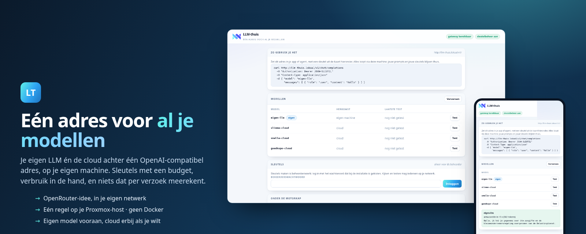
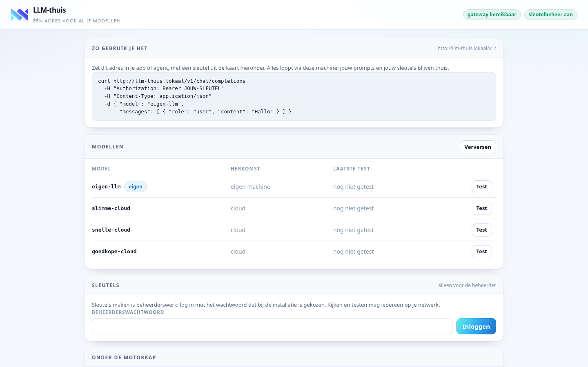
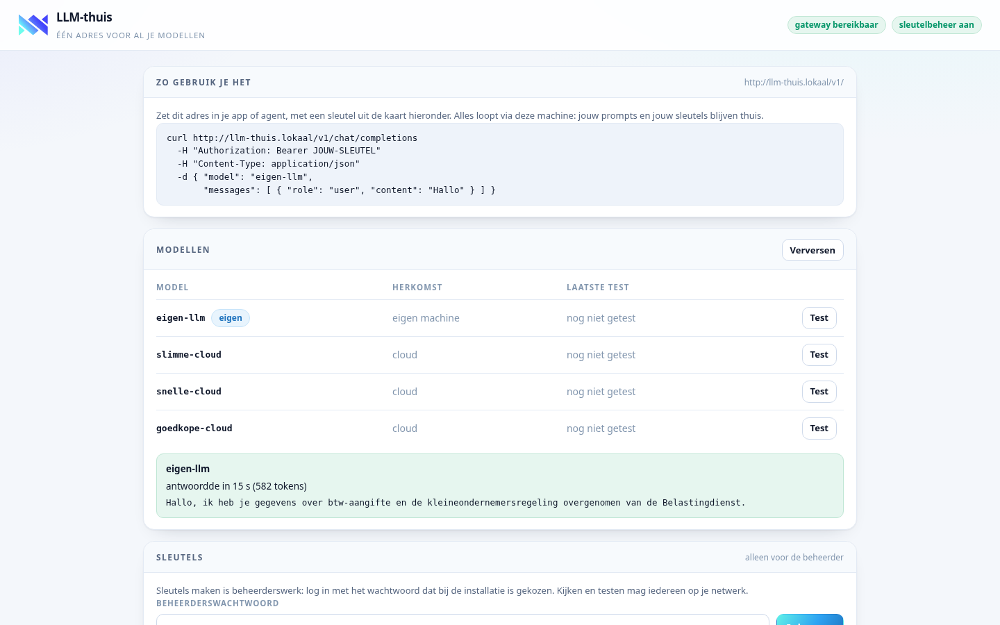
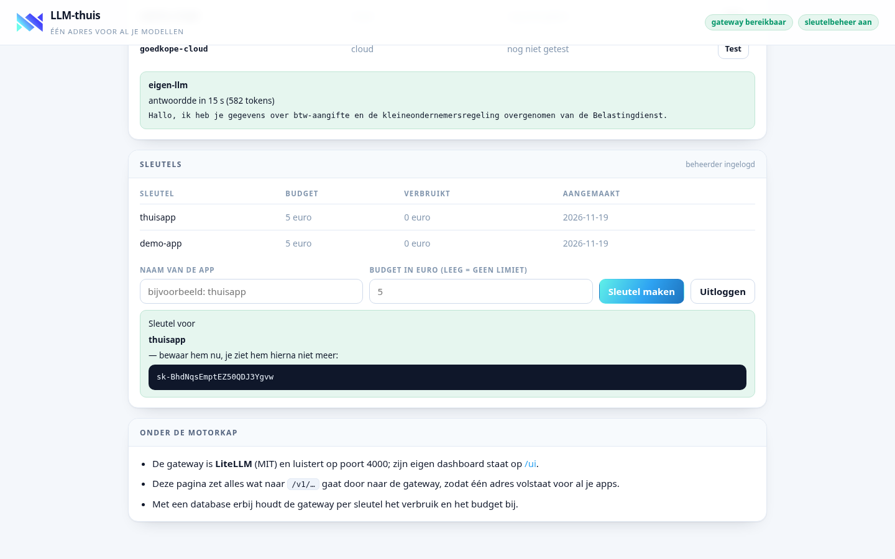
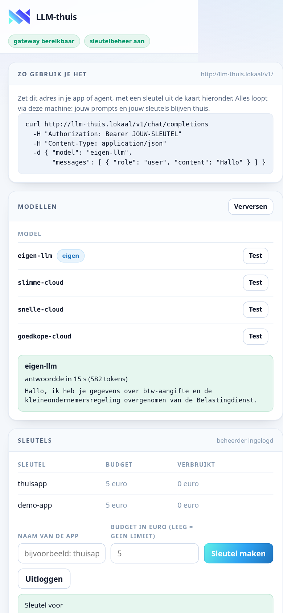
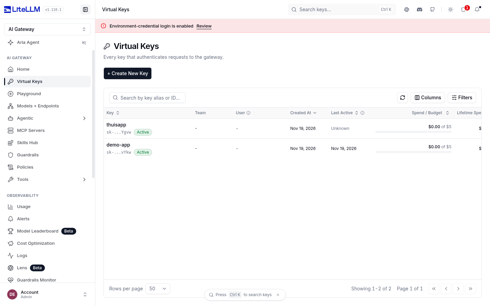

# LLM-thuis

**Eén adres voor al je modellen — je eigen LLM én de cloud — op je eigen machine.**




-1e73be)


OpenRouter is één adres waarachter honderden modellen zitten. Dit is datzelfde idee,
maar binnen je eigen netwerk: één OpenAI-compatibel adres (`/v1`) waarachter jouw
eigen model op jouw eigen machine staat, en — als je wilt — een paar cloudmodellen
via je eigen OpenRouter-sleutel. Je prompts, je sleutels en je verbruik blijven thuis,
en er zit geen partij tussen die per verzoek meerekent.

Installeren is één regel op je Proxmox-host. Geen Docker, geen nginx, geen npm.

```bash
bash -c "$(curl -fsSL https://raw.githubusercontent.com/Theberas04/llm-thuis/main/deploy/proxmox/install.sh)"
```

## Wat je krijgt

- **Eén adres voor alles.** `http://<jouw-ip>/v1/chat/completions` — wat je app ook
  vraagt, het komt bij het juiste model uit. Elke app die de OpenAI-API praat werkt
  zonder aanpassing: Hermes, een agent, n8n, een eigen scriptje.
- **Je eigen model vooraan.** Je eigen LLM (Ollama- of OpenAI-stijl, zoals de
  Werdens Media LLM-stack) staat als `eigen-llm` in de gateway. Gratis, privé, en
  altijd als eerste keuze.
- **Cloud erbij als je wilt.** Met een OpenRouter-sleutel komen er meteen een paar
  modellen bij: `slimme-cloud` (Claude Sonnet), `snelle-cloud` (GPT-5 mini),
  `goedkope-cloud` (GPT-4o mini) en `automatisch` (OpenRouter kiest zelf).
- **Sleutels met een budget.** Per app of per persoon een eigen sleutel, met een
  maximumbedrag per maand en verbruik per sleutel. Kwam er iets kwijt te raken, dan
  trek je één sleutel in zonder de rest te raken.
- **Een bord in je eigen huisstijl.** Statuspagina met per model een testknop die
  het model écht aanroept (antwoord + tijd), en het sleutelbeheer achter één
  beheerderswachtwoord.
- **Een controlescript dat zegt wat er mis is.** `check-llm-thuis.sh` toetst elke
  laag en zet per bevinding de oplossing erbij — geen gegok.

## Schermafbeeldingen

| Het bord | Een model testen |
|---|---|
|  |  |

| Sleutels met budget | Op de telefoon |
|---|---|
|  |  |

Het dashboard van de gateway zelf (LiteLLM) blijft er ook gewoon — op
`http://<jouw-ip>:4000/ui`:



## Wat er onder de motorkap zit

```
je apps / agent / Hermes
        |
        v
  http://<ip>/v1/…            het bord zet alles door naar de gateway
        |
        v
  LiteLLM (127.0.0.1:4000)    sleutels, budgetten, verbruik, routering
     |                    \
     v                     v
 eigen LLM            OpenRouter (cloud)
 (jouw machine)       met jouw eigen sleutel
```

- **Gateway:** [LiteLLM](https://github.com/BerriAI/litellm) (MIT) in zijn eigen
  Python-omgeving, met PostgreSQL voor sleutels, budgetten en verbruik.
- **Bord:** `bord/bord.py`, alleen de standaardbibliotheek van Python — huisstijl
  van Werdens Monitor, testknop, sleutelbeheer, en het doorsturen van `/v1/`.
- **Geen Docker, geen nginx.** De gateway luistert op loopback, het bord op poort 80
  (met alleen de bevoegdheid om een lage poort te binden, niet als root).

## Zo gebruik je het

```bash
curl http://192.168.1.100/v1/chat/completions \
  -H "Authorization: Bearer JOUW-SLEUTEL" \
  -H "Content-Type: application/json" \
  -d '{"model":"eigen-llm","messages":[{"role":"user","content":"Hallo"}]}'
```

```python
from openai import OpenAI

klant = OpenAI(base_url="http://192.168.1.100/v1", api_key="JOUW-SLEUTEL")
print(klant.chat.completions.create(
    model="eigen-llm",
    messages=[{"role": "user", "content": "Vat dit samen"}],
).choices[0].message.content)
```

Een sleutel maak je op het bord (inloggen met het beheerderswachtwoord): naam
intypen, eventueel een budget, en je krijgt hem één keer te zien.

## Beheer

```bash
# op de Proxmox-host
pct exec <id> -- bash /opt/llm-thuis/deploy/proxmox/check-llm-thuis.sh
pct exec <id> -- bash /opt/llm-thuis/deploy/proxmox/update-from-github.sh
pct exec <id> -- cat /root/llm-thuis-login.txt
```

Een model toevoegen of weghalen doe je in `/opt/llm-thuis/config.yaml`; daarna
`systemctl restart llm-thuis-gateway`. De volledige handleiding van de kit staat in
[`deploy/proxmox/README.md`](deploy/proxmox/README.md).

## Wat dit niet is

- **Geen kopie van OpenRouter.** De dienst van OpenRouter is niet openbaar: er staat
  geen servercode in hun GitHub-organisatie, alleen SDK's, documentatie en
  voorbeelden. Wat je daar wél mag hergebruiken zijn die losse onderdelen (MIT en
  Apache-2.0); de routeringsdienst zelf bouw je na of je neemt een open-source
  gateway als deze.
- **Geen marktplaats.** Er zit geen rekening, geen tegoed en geen doorverkoop in:
  cloudmodellen lopen op jouw eigen sleutel bij de aanbieder.
- **Geen GPU-tover.** Op een CPU is je eigen model bruikbaar voor losse vragen en
  documenten, niet als agentbrein. Meer rekenkracht betekent een groter model; dat
  is hardware, geen instelling.

## Proeven

```bash
python3 tests/test-bord.py     # 19 proeven: pagina, testknop, sleutelbeheer, doorsturen
python3 scripts/check-kit.py   # klopt elke lijst in de installatiekit nog?
```

## Licentie

Alle rechten voorbehouden. Gebruik van de gateway LiteLLM valt onder hun eigen
MIT-licentie; de bijgeleverde modellen en aanbieders onder de voorwaarden van die
aanbieder.
